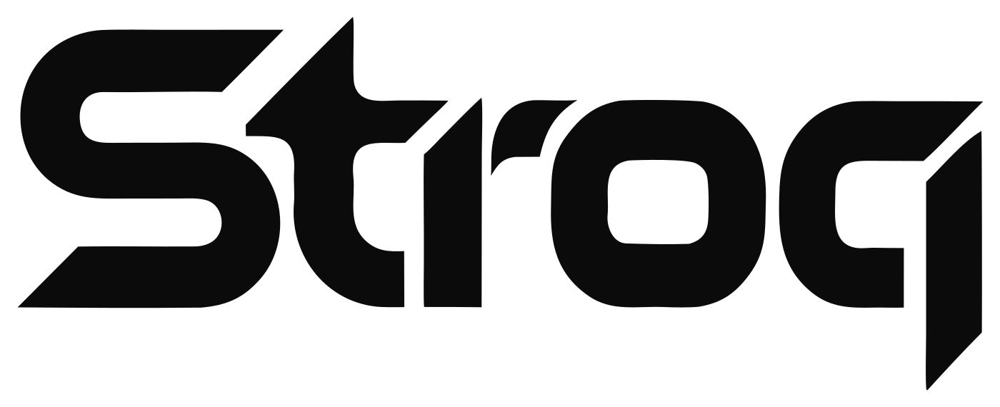

<div align="center">

<picture>
  <source media="(prefers-color-scheme: dark)" srcset="docs/assets/logo-dark.svg">
  
</picture>

### Find known secrets in AI coding agent sessions

[](https://github.com/AGGIB/Stroq/actions/workflows/ci.yml)
[](docs/GUIDE.md#replay-thirty-six-attacks-from-public-reports-and-synthetic-cells)
[](https://www.npmjs.com/package/@stroq/cli)
[](https://www.npmjs.com/package/@stroq/cli)
[](LICENSE)

</div>

Stroq scans recorded Claude Code, Codex CLI and Cursor sessions for values matching credentials on your machine. It names the credential and the tool call without printing the value, then helps guard supported actions in future sessions. A local transcript match does not by itself prove delivery to a model provider.

```bash
npx @stroq/cli sent          # every recorded session on this machine; no hook setup needed
npx @stroq/cli sent --last   # only the newest session of this project
npx @stroq/cli init          # hook into your agent and guard the next session
```

Needs Node.js 22 or newer.

What a finding looks like (made-up keys, the built CLI's output, trimmed):

```text
stroq sent: did your AI agent pass your keys on?

6 of your 6 keys appear in your agent sessions: 2 sent to another company, 1 maybe sent, 1 seen by the AI, 1 used with its own service, 1 blocked before it ran.

Checked 3 sessions (Claude Code 2, Codex 1), 2026-10-02 to 2026-10-19.
Compared with 6 keys: ~/.aws/credentials, ~/.npmrc, ~/work/shop/.env, ~/work/api/.env.

SENT TO ANOTHER COMPANY: rotate these today (2)
 1. STRIPE_SECRET_KEY  from ~/work/shop/.env
    went to  collector.example, in a curl command
    when     2026-10-11 14:02 UTC · Claude Code · ~/work/shop
    do       revoke it at https://dashboard.stripe.com/apikeys, then update ~/work/shop/.env

SEEN BY THE AI: your agent's model saw these keys (1)
 4. aws_secret_access_key  from ~/.aws/credentials
    seen in  the output of a Read of ~/.aws/credentials
    when     2026-10-02 09:42 UTC · Claude Code · ~/work/api
    note     Not ruled out: 2 later commands in that session could reach the network.
    do       your agent's model saw it; rotate it if that matters: https://console.aws.amazon.com/iam/home#/security_credentials

Stroq names a send only when it sees the key in the command that sent it. A script, a file or a variable can carry a key out without showing it.
```


- **Looks back.** `stroq sent` reads local Claude Code, Codex CLI and Cursor records, including sessions from before Stroq was installed. It matches known values in available tool arguments and results, and reports names and sources, not values. It reads local credential files to know what to compare and keeps the values in memory only; it writes no file but a card you ask for with `--card --out`. Old, rotated or unknown values may be missed. It says only what it saw: a key it did not see leave may still have left in a script, a file or a variable.
- **Guards what's next.** Native hooks for Claude Code, Cursor, Codex, Copilot CLI, Windsurf and Antigravity, a plugin for OpenClaw, and a stdio MCP proxy. Supported outbound calls containing a known secret can be denied; provenance ties some later actions to earlier tool output. Coverage depends on the host, version and channel.
- **Local.** No outbound network calls from the hooks; Task Lock hooks speak only to their local parent controller. No telemetry. Apache-2.0.

Start with the [session secret scan walkthrough](https://stroq.dev/session-secret-scan/) (no session yet? [try it with a made-up key](https://stroq.dev/session-secret-scan/#try-it)) or read [integration limits](docs/AGENTS.md) before relying on a live hook.

## Local console

```sh
npx @stroq/cli console                            # a private page on 127.0.0.1
npx @stroq/cli console --workspace /path/to/repo  # the project it should look at
```

Open the whole link it prints: it carries a key that is new each time the console starts. The console reads what Stroq already records on this machine. It changes an agent's settings or Stroq's policy only after you confirm a preview of that change; checks you run are saved under `~/.stroq`.

- **Protection** answers first: which agents are asking Stroq before they act, which are connected but not seen yet, and which are not connected. Connected means Stroq's hooks are in the agent's settings, not that the agent calls them; **Test hook** and **Live** show that.
- **Live** follows recorded decisions as they happen; **Activity** keeps them.
- **Agents & coverage** adds or removes Stroq's hooks for Claude Code, Cursor and Codex CLI, showing the exact file change first and keeping a copy of the old file.
- **Settings check** lists agent settings that switch off or loosen protection, and says which files it could not read. **Try an action** shows what your policy would decide for a command, read, write or fetch without running it.
- Skills & MCP, investigations, sessions and secret exposure are under **When you need it**; the **Guide** page says what each page is for and what its words mean.

It listens only on 127.0.0.1, needs no account and has no telemetry. With the optional threat feed turned on in Settings, it downloads [pwn.watch](https://pwn.watch/)'s public list of incidents; nothing about your project is sent. One action starts your real agent: **Test in agent** runs it against a throwaway project, with a cap on requests, and uses your agent's own subscription. Adding hooks from the console needs macOS or Linux; on Windows use `stroq init`. Details and limits: [console guide](console/README.md).

From a source checkout:

```sh
pnpm install --frozen-lockfile
pnpm --dir console install --ignore-workspace --frozen-lockfile
pnpm platform:build
pnpm platform --workspace /path/to/repo
```

## Docs

- **[Guide](docs/GUIDE.md)**: everything, section by section. [Install](docs/GUIDE.md#install) · [Commands](docs/GUIDE.md#commands) · [How it works](docs/GUIDE.md#how-it-works) · [Guarantees and limits](docs/GUIDE.md#guarantees-and-limits)
- [Per-agent details](docs/AGENTS.md): what each agent's hooks allow, and every documented limit
- [False positives](docs/BENCH.md) · [Attack coverage](docs/COVERAGE.md) · [Cloak vs AgentCloak](docs/CLOAK-COMPARISON.md)
- [Security](SECURITY.md) · [Changelog](CHANGELOG.md) · [Contributing](CONTRIBUTING.md)

## Contributors

Thank you to everyone who contributes code, reports bugs, tests agent integrations, and improves the docs ❤️

[](https://github.com/AGGIB/Stroq/graphs/contributors)

[stroq.dev](https://stroq.dev)
