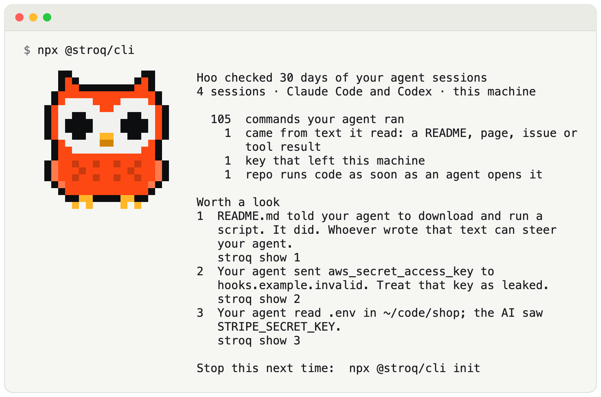
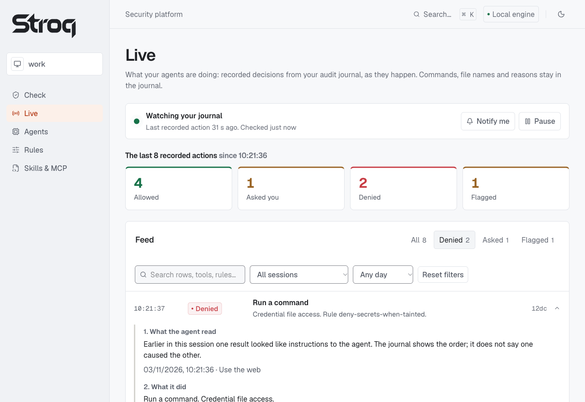

<div align="center">

<picture>
  <source media="(prefers-color-scheme: dark)" srcset="https://raw.githubusercontent.com/AGGIB/Stroq/main/docs/assets/logo-dark.svg">
  
</picture>

### Who is really in charge of your agent?

[](https://github.com/AGGIB/Stroq/actions/workflows/ci.yml)
[](https://github.com/AGGIB/Stroq/blob/main/docs/GUIDE.md#replay-thirty-six-attacks-from-public-reports-and-synthetic-cells)
[](https://www.npmjs.com/package/@stroq/cli)
[](https://github.com/AGGIB/Stroq/blob/main/LICENSE)

</div>

Stroq reads your own Claude Code and Codex sessions and shows how many commands came from text your agent read, and which keys left your machine.

<picture>
  <source media="(prefers-color-scheme: dark)" srcset="https://raw.githubusercontent.com/AGGIB/Stroq/main/docs/assets/readme/card-dark.png">
  
</picture>

<sub>An example: a made-up machine with made-up sessions, keys and hosts. Hoo is Stroq's owl. Your card shows your own sessions.</sub>

```bash
npx @stroq/cli
```

It reads your last 30 days of sessions, your key files and the folders your agent worked in; prints key names, never values; writes nothing but a small cache under `~/.stroq`; and sends nothing. No account, no telemetry.

```text
npx @stroq/cli            a card of your own sessions, like the one above
npx @stroq/cli init       stop it next time: guard your agent
npx @stroq/cli why        why an action was stopped
npx @stroq/cli attack     watch Stroq stop 36 known attacks, in a sandbox
npx @stroq/cli uninstall  remove Stroq
```

Every moment on the card has a `stroq show` line that prints the evidence behind it (`npx @stroq/cli show 1`). `stroq help --all` lists the other commands. Needs Node.js 22 or newer. Apache-2.0.

## Beyond the card

Stroq is a local security platform for AI coding agents: Claude Code, Cursor, Codex CLI and others. Its hooks judge every tool call before it runs. They deny `curl | sh` and outbound calls that carry a known secret from your machine, and they ask you first when a command repeats text the agent read, naming that text. The console shows which agents actually ask Stroq, and every decision with its reason. Sessions you already had can be checked too, without installing anything.

```bash
npx @stroq/cli console           # the console: a private page on 127.0.0.1
npx @stroq/cli replay --all      # your Claude Code sessions of the last 30 days against the policy; no hooks needed
npx @stroq/cli sent              # did your agent pass your keys on? key names, never values
npx @stroq/cli sent --try        # a built-in sample with a made-up key; reads nothing
npx @stroq/cli init              # hook into your agent and guard the next session
```



**Did your AI agent pass your keys on?** `stroq sent` reads the Claude Code, Codex and Cursor sessions on your machine and looks for the exact values of your keys in them. For each key it finds, it says where the key went: sent to another company, maybe sent, seen by the AI, used with its own service, or blocked before it ran. It prints key names, never values, and writes nothing.

What a finding looks like (made-up keys, trimmed):

```text
stroq sent: did your AI agent pass your keys on?

6 of your 6 keys appear in your agent sessions: 2 sent to another company, 1 maybe sent, 1 seen by the AI, 1 used with its own service, 1 blocked before it ran.

Checked 3 sessions (Claude Code 2, Codex 1), 2026-10-02 to 2026-10-19.
Compared with 6 keys: ~/.aws/credentials, ~/.npmrc, ~/work/shop/.env, ~/work/api/.env.

SENT TO ANOTHER COMPANY: rotate these today (2)
 1. STRIPE_SECRET_KEY  from ~/work/shop/.env
    went to  collector.example, in a curl command
    when     2026-10-11 14:02 UTC · Claude Code · ~/work/shop
    do       revoke it at https://dashboard.stripe.com/apikeys, then update ~/work/shop/.env

SEEN BY THE AI: your agent's model saw these keys (1)
 4. aws_secret_access_key  from ~/.aws/credentials
    seen in  the output of a Read of ~/.aws/credentials
    when     2026-10-02 09:42 UTC · Claude Code · ~/work/api
    note     Not ruled out: 2 later commands in that session could reach the network.
    do       your agent's model saw it; rotate it if that matters: https://console.aws.amazon.com/iam/home#/security_credentials

Stroq names a send only when it sees the key in the command that sent it. A script, a file or a variable can carry a key out without showing it.
```

Run these commands with Node.js 22 or newer. They work on sessions from before Stroq was installed. `npx` downloads the CLI from npm. To know what to look for, `sent` reads your key files (`~/.aws/credentials`, `~/.npmrc`, `~/.netrc`, `~/.docker/config.json`, project `.env` files) and your environment, and keeps the values in memory only. "Went to" means a recorded call carried the key; it does not show what the host kept. See the [guide's coverage and limits](https://github.com/AGGIB/Stroq/blob/main/docs/GUIDE.md#which-credentials-appeared-in-a-recorded-agent-session).

**Guard future sessions:** Stroq scans content visible to installed agent hooks, carries suspicion and source information into later decisions, and applies a local policy to the tool calls those hooks expose. It supports native hooks, an OpenClaw plugin and a stdio MCP proxy; coverage differs by agent and channel. The hooks do not send telemetry.

Supported today: **Claude Code**, **Cursor**, **Codex**, **Copilot CLI**, **Windsurf**, **Google Antigravity** (native hooks) · **OpenClaw** (in-process plugin) · **any MCP client** (stdio proxy).

## Install

```bash
npx @stroq/cli init                  # Claude Code: writes .claude/settings.json hooks
npx @stroq/cli init --agent cursor   # Cursor: writes .cursor/hooks.json
npx @stroq/cli init --agent codex    # Codex CLI: writes .codex/hooks.json
npx @stroq/cli init --agent copilot  # Copilot CLI: writes .github/hooks/stroq.json
npx @stroq/cli init --agent openclaw # OpenClaw: installs a plugin into ~/.stroq/openclaw-plugin
npx @stroq/cli init --agent windsurf # Windsurf: merges into .windsurf/hooks.json
npx @stroq/cli init --agent antigravity # Google Antigravity: merges into .agents/hooks.json
npx @stroq/cli init --agent mcp --client claude-desktop   # any MCP client: wraps its stdio servers
npx @stroq/cli doctor                # check the installation
```

`init` writes hooks into the project's `.claude/settings.json` by default; pass `--user` to install into `~/.claude/settings.json` instead, or `--dry-run` to preview the change.

Prefer a persistent install? `npm install -g @stroq/cli` installs the `stroq` command globally — then run `stroq init` and `stroq doctor` directly.

`doctor --json` keeps its version 1 installation-wide `ok` and exit semantics, and adds `diagnosticsVersion:1` with finite reason/scope facts on each check. An absent agent can still have `ok:true` when another agent is configured; its typed observation says `not-configured`. These are recorded offline checks, not current native-host blocking proof. The human-readable report remains unchanged.

### Local security platform (source build)

This checkout also builds the console, a private page with five screens: Check (the card of your sessions), Live (the audit journal), Agents (hooks and settings), Rules (the policy) and Skills & MCP (what your agents load). Build and start it locally:

```bash
pnpm install --frozen-lockfile
pnpm --dir console install --ignore-workspace --frozen-lockfile --ignore-scripts
pnpm platform:build
node packages/cli/dist/index.js console --workspace /path/to/project --port 47815
```

Open the private URL printed at startup. The server binds only to `127.0.0.1`; its fragment token grants access to the selected workspace and OS user, so keep that URL private. `--port 0` selects an available local port. Starting the console does not install hooks or run an agent. A change to an agent's settings or to Stroq's policy is written only after you confirm a preview of it.

**Rules → History** makes retained policy backups usable from the console. Test the selected prior bytes against the current policy and saved checks before explicitly restoring them. A prior absent file offers the current bundled default, with separate consent for reduced protection, shared scope and private recovery copies. See [tested policy recovery](https://github.com/AGGIB/Stroq/blob/main/docs/platform/policy-recovery.md).

**Agents → Test hook** checks the exact captured source of an agent's hook with two fixed events, offline and with no provider requests. The recorded result stays separate from hook approval and native blocking. See [isolated hook checks](https://github.com/AGGIB/Stroq/blob/main/docs/platform/hook-checks.md).

`npm pack` in `packages/cli` prepares a self-contained local tarball: the split CLI, static UI, local services, engine workers and required data all ship together. It installs the console's committed lockfile independently and builds the platform before packing. An installation of that tarball can run `stroq console` without the source checkout, Next.js or a separate frontend installation. Preparing a tarball does not publish it; this source feature has not been released to npm by this work.

Windsurf note: `post_read_code` cannot scan a directory Cascade reads recursively (it scans the file it names, and a directory reads as empty), and a tainted `pre_read_code` of `~/.ssh` or `~/.aws` without a trailing slash is not classified as a secret path either — see the [Windsurf section of the full README](https://github.com/AGGIB/Stroq/blob/main/docs/AGENTS.md#windsurf) for this and every other documented limit.

MCP proxy note: for clients with no hook API, `--agent mcp` rewrites the client's `mcpServers` entries so each stdio server starts through `stroq mcp`, which judges every `tools/call` and scans every result. There is no way to prompt from inside a proxy, so a policy `ask` arrives as a blocked tool result naming the rule; HTTP (`url`/`serverUrl`) servers are skipped; and the project directory is the one `init` ran in — see the [MCP proxy section of the full README](https://github.com/AGGIB/Stroq/blob/main/docs/AGENTS.md#mcp-proxy-any-mcp-client) for this and every other documented limit. `--agent mcp --strict` additionally withholds, audits and counts every server message the proxy could not fully read and scan (an oversize or unparsable line, an unsolicited response, sampling and other server-initiated requests, fields it does not read, a scan that throws or passes a hard deadline) and answers the waiting request with a fixed error; the same section has the table and the limits.

## MCP runtime pins

`stroq mcp --server <name> --client <client> --pin sha256:<64 lowercase hex> -- node <absolute store entrypoint> [server arguments]` refuses to start unless the same server name and digest are confirmed in this machine's `passports.json`. It checks every stored file against the `stroq-tree/1` manifest, reads the source bytes once, and launches those bytes from a fresh private directory under `<STROQ_HOME>/run` (owned by the current user, mode 0700 on POSIX). The copy is normally removed after the server exits, including shutdown through SIGINT, SIGTERM or SIGHUP; SIGKILL, a crash during preparation, or a filesystem cleanup error can leave a copy there. Remove leftovers only after their servers have stopped. Windows relies on the user's home-directory ACL; POSIX mode bits do not establish Windows ACL isolation.

The server's working directory is the private copy, so relative paths refer to the confirmed tree rather than the project. `--cwd` selects the project for Stroq's decisions only. Every whole absolute argument inside the store tree is relocated to the corresponding file or directory in the copy; embedded references such as `--config=<store tree>/config.json` are refused, so pass the path as a separate argument. The Node runtime is the one running Stroq; Node loader flags before the entrypoint, package runners such as `npx`, and entrypoints outside the store are refused. Pinned wrappers with no environment record use the filtered infrastructure environment. Repeated `--pin` flags and malformed pins are usage errors.

A pin is written by `stroq add --kind mcp`, which 0.30 removed, so what follows is for wrappers an older version made. The pin holds such a wrapper to what `add` wrote, exactly: the proxy compares the whole command line it was started with (node, its flags, the Stroq entry, every flag and the command after `--`) with the recorded entry, token by token, and refuses to start on any difference, an added `--cloak` or a hand-made rewrite included (the refusal and `stroq doctor` print the command that takes the pin out: `stroq init --agent mcp --unwrap`, after which a plain `stroq init --agent mcp` wraps the server again without it). `stroq doctor` also compares the entry's `env`, `cwd` and other keys, and reports a pin that was taken out. A record with only a name and a digest is held to those.

`stroq init --agent mcp` leaves a pinned wrapper that the lock confirms exactly as it is, prints `kept <name>` for it, and prints the command that takes the pin out so that a rewrite with a new directory, node or flags can apply. This also applies to `init --strict`: it keeps those entries unchanged. A wrapper with a `--pin` that no confirmation here records is still rewritten with its `--pin` flags kept, invalid pins included, which keep failing closed. Rewriters that use `wrapMcpConfig` keep that behavior and leave the names in `confirmed` alone. `--unwrap` removes the pin along with the wrapper and prints a notice. `stroq doctor` checks each configured pin offline, and `stroq exposure` reports a changed or unverifiable pinned server as `mcp-pin-drifted`. Neither check starts the server.

The shared lock layout is `{ "v": 1, "skills": {}, "mcp": { "<server name>": { "kind": "mcp", "status": "confirmed", "digest": "<64 lowercase hex>", "grant": { "pin": "sha256:<same digest>" } } } }`. The `skills` and `mcp` buckets are intentional: their writers must preserve each other's records. The schema lives in `install/passports-schema.ts`, read through `install/lock-reader.ts` and shared with install writers; the lock reader refuses files over 4 MiB with a distinct size-limit diagnostic.

This is **tamper-evident, not tamper-proof**: the same user can change the store, lock or private copy. The pin covers the shipped tree of a self-contained Node server; a package absent from that tree can still be resolved from an ancestor's `node_modules` and is not covered by the pin. `stroq add --kind mcp` (removed in 0.30) therefore refused a server whose `package.json` lists dependencies, whose sources import a package by name, or whose files it cannot read with certainty (a module name built at run time, `createRequire`, `eval`, an import of a path outside the tree), and `stroq vet` prints the blind spot `imports resolve outside the pin` for one. The reading of the text is best-effort and not a proof that no import escapes; a wrapper written by hand can still pin such a server. The private runtime folder prevents a module planted above a shared temporary copy from being used, but does not sandbox package resolution or the server, attest the Node executable, or cover code fetched at runtime. The pin itself is a flag in the client config: an agent able to edit `.mcp.json` or `.cursor/mcp.json` can remove it, and offline diagnostics inspect only entries that still carry a pin. The plain lock records neither who confirmed nor a signature. `stroq add --kind mcp` wrote the record after a person typed the digest at a terminal, and the proxy holds the wrapper to what that record keeps; a record written by hand with only a name and a digest is accepted and held to those. A wrapper without `--pin` retains its existing behavior.

## Commands

| Command                                                                                                                | What it does                                                                                                                                                                                                                                                                                                                                                                                                                                                                                                                                |
| ---------------------------------------------------------------------------------------------------------------------- | ------------------------------------------------------------------------------------------------------------------------------------------------------------------------------------------------------------------------------------------------------------------------------------------------------------------------------------------------------------------------------------------------------------------------------------------------------------------------------------------------------------------------------------------- |
| `stroq card [--days <n>] [--json] [--share] [--plain] [--no-animation]`                                                | What `stroq` alone runs: reads the last 30 days of Claude Code and Codex sessions on this machine and prints the commands your agent ran, how many a text it had read told it to run, keys sent to another company and repositories that run code as soon as an agent opens them, then the moments worth a look, with Hoo the owl beside it on a terminal. Nothing runs and nothing is sent; it exits 0. `--json` prints schema `stroq-card/1`, `--share` one line of counts with no path, name or host, `--plain` the text without the owl |
| `stroq show <n>`                                                                                                       | Print the evidence behind moment `<n>` of the last card: what was read, what the agent did, how they are linked, the session and the transcript to replay                                                                                                                                                                                                                                                                                                                                                                                   |
| `stroq console [--workspace <directory>] [--port <number>]`                                                            | Start the authenticated local security platform on loopback for an existing workspace. Keep its private URL token secret; configuration changes, credential scans and provider checks require their separate platform confirmation.                                                                                                                                                                                                                                                                                                         |
| `stroq init [--agent <name>] [--user] [--dry-run] [--yes] [--no-input]`                                                | Install hooks for `claude-code`, `cursor`, `codex`, `copilot`, `openclaw`, `windsurf` or `antigravity`, or wrap an MCP client's stdio servers with `--agent mcp` (`--client <name>` or `--config <path>`; `--user` for the home-directory copy, `--unwrap` to restore, `--cloak` to redact, `--strict` to withhold unread messages; entries confirmed by `add` are kept). `--yes` answers terminal prompts, `--no-input` runs non-interactively                                                                                             |
| `stroq uninstall [--agent <name>] [--user] [--dry-run]`                                                                | Take Stroq's hooks out of an agent's config, leaving everything else as it was; with `--agent mcp`, unwrap servers via `--client <name>` or `--config <path>`                                                                                                                                                                                                                                                                                                                                                                               |
| `stroq hook <agent>`                                                                                                   | Hook entrypoint (reads the event on stdin; `copilot` and `openclaw` take a `pre`/`post` argument, `antigravity` takes `pre`, `post` or `preinvocation`, the others take none)                                                                                                                                                                                                                                                                                                                                                               |
| `stroq mcp --server <name> -- <cmd>`                                                                                   | MCP stdio proxy: judges every `tools/call` and scans every result; an optional runtime pin checks locally confirmed server bytes before starting a private copy; `--strict` withholds what it cannot fully scan With `--strict --tool-approval` and explicit `--pass-env`, exact tool contracts require local platform approval; this cannot be combined with `--cloak`.                                                                                                                                                                    |
| `stroq doctor [--all] [--json]`                                                                                        | Check Node version, rules, hooks for every agent and when each last called Stroq, self-test; `--all` lists every agent and scope, installed or not; `--json` emits the version 1 report as JSON                                                                                                                                                                                                                                                                                                                                             |
| `stroq log [--count 20] [--json]`                                                                                      | Show recent audit entries; `--json` prints one entry per line                                                                                                                                                                                                                                                                                                                                                                                                                                                                               |
| `stroq verify`                                                                                                         | Verify the audit hash chain                                                                                                                                                                                                                                                                                                                                                                                                                                                                                                                 |
| `stroq untaint [--session <id>] [--all]`                                                                               | Clear a false-positive session's taint and provenance, or every session's                                                                                                                                                                                                                                                                                                                                                                                                                                                                   |
| `stroq trust [<file>] [--list] [--remove <file>] [--json]`                                                             | Waive a false positive on a file's exact content; any change to the file taints again. `--list`, or no argument, shows what is trusted; `--remove <file>` stops trusting a file; `--json` emits JSON                                                                                                                                                                                                                                                                                                                                        |
| `stroq why [--seq <n>]`                                                                                                | Explain the most recent denied/asked action: rule, provenance, taint                                                                                                                                                                                                                                                                                                                                                                                                                                                                        |
| `stroq sent [--here] [--last] [--transcript <path>] [--try] [--json] [--counts] [--fail-if third-party\|any]`          | Check the recorded sessions on this machine for the exact values of your keys, and say where each one went: sent to another company, maybe sent, seen by the AI, used with its own service, or blocked. Prints names, never values, and writes nothing. `--try` runs the check on a built-in sample with a made-up key                                                                                                                                                                                                                      |
| `stroq replay [--last] [--transcript <path>] [--json]`                                                                 | Reconstruct which recorded content preceded later agent actions and show the matching evidence                                                                                                                                                                                                                                                                                                                                                                                                                                              |
| `stroq canary [--name <NAME>] [--file <path>]`                                                                         | Print a canary secret to plant; its outbound use is denied and taints the session. `--file` plants it as a decoy file: any call naming the file is denied and taints the session                                                                                                                                                                                                                                                                                                                                                            |
| `stroq attack [--json] [--only <id>] [--fuzz] [--host <id>]`                                                           | Replay 36 documented-incident and synthetic scenarios against your policy; `--fuzz` crosses each with a deterministic mutation set and reports variants that reach `allow`; `--host` filters by host channels; exit 1 if any gets through                                                                                                                                                                                                                                                                                                   |
| `stroq policy check [<file>] [--json]`                                                                                 | Load a policy file as the hook does and list what is wrong: faults by field, a rule that can never match, a protection of the default policy it drops, `default: allow`, a high `threshold`. Exit 1 on a finding                                                                                                                                                                                                                                                                                                                            |
| `stroq policy test [--policy <file>] [--cases <file>]`                                                                 | Replay the attack corpus, ordinary work and your cases under a policy and a baseline (`--baseline`); print each step whose decision changed. Exit 1 if an attack passes or `--max-new-interruptions <n>` is exceeded                                                                                                                                                                                                                                                                                                                        |
| `stroq exposure [--probe] [--share] [--json]`                                                                          | Map this machine's agent surface and report what reaches you; exit 1 on any finding                                                                                                                                                                                                                                                                                                                                                                                                                                                         |
| `stroq inspect [<dir>] [--changed-from <rev>] [--format text\|json\|sarif\|github] [--fail-on new\|any\|none] [--env]` | Read what a repository runs before you open it with an agent or editor; exit 1 when something fails the check. `--changed-from <rev>` marks each entry new, changed or already there, for a pull request. `--format sarif` (or `--sarif`) writes SARIF 2.1.0, `--format github` a job summary and annotations, `--json` is `--format json`. `--fail-on new\|any\|none` picks what fails. `--env` prints the git settings that neutralise it                                                                                                 |
| `stroq vet (--from <dir or .tgz> \| --online <spec>) [--json\|--card]`                                                 | Read a skill, MCP server or plugin (folder, .tgz or online npm/GitHub source) before you add it, and print its passport: what it asks for or can do, and every blind spot. Reads, never runs. `--expect <sha256>` checks the digest. Not a security certificate                                                                                                                                                                                                                                                                             |

`stroq exposure` reads files only. `--probe` is the one flag that starts a process: it launches each configured stdio MCP server, asks once for `tools/list`, scans the tool descriptions and shuts the server down — no tool is ever called. Without it, tool-description poisoning is not covered by the run, and the report says so. `--share` prints a redacted summary built from a whitelist, locally; nothing is transmitted.

The corpus `pnpm dev:bench` measures against ships with this repository, not with the npm package; the published number in [`docs/BENCH.md`](https://github.com/AGGIB/Stroq/blob/main/docs/BENCH.md) is that tool run against the vendored corpus, and `pnpm dev:bench -- --corpus <dir>` runs it on your own documentation from a checkout.

## Installing skills and MCP servers

`stroq add` and `stroq remove` were removed in 0.30. Read what you are about to install, then install it with your agent's own command:

```bash
stroq vet --from ./my-skill          # read first; runs none of the skill's code
stroq vet --from ./my-server --kind mcp --probe   # a sandboxed MCP handshake, after a terminal question
```

`stroq vet` prints the passport and full SHA-256 digest of a folder or `.tgz`: what it asks for or can do, each line marked declared, observed, limited or unknown, the rules that matched, and every blind spot. A passport is a reading, not a security certificate. What an older `stroq add` already installed keeps being checked: `stroq doctor` verifies the stored bytes of each recorded skill, and `stroq mcp --pin` starts a pinned server only from its confirmed bytes. The store is tamper-evident, not tamper-proof: the same user can edit it.

## Learn more

The local platform can explicitly enable **Protect & review tools** on an eligible stdio registration. Its `mcp --strict --tool-approval --pass-env <names>` mode holds discovery and calls until exact advertised tool versions have been reviewed. It requires a fresh complete listing per connection. After a client root `tools/list`, the proxy can collect up to 16 pages in 30 seconds, strictly scan every page and the aggregate, and return one complete result; malformed/incomplete walks and unsupported metadata are refused. The console never probes the server. Policy and strict scanning remain independent, and approval never retries a call. Metadata is retained unencrypted in the private Stroq store. See the [tool-contract workflow and boundaries](https://github.com/AGGIB/Stroq/blob/main/docs/platform/mcp-tool-contracts-plan.md).

- Full documentation, architecture, and the demo: [github.com/AGGIB/Stroq](https://github.com/AGGIB/Stroq/blob/main/docs/GUIDE.md)
- Report a security issue or a bypass: [SECURITY.md](https://github.com/AGGIB/Stroq/blob/main/SECURITY.md)

License: Apache-2.0.
